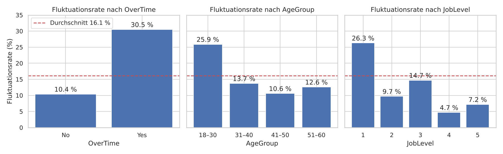
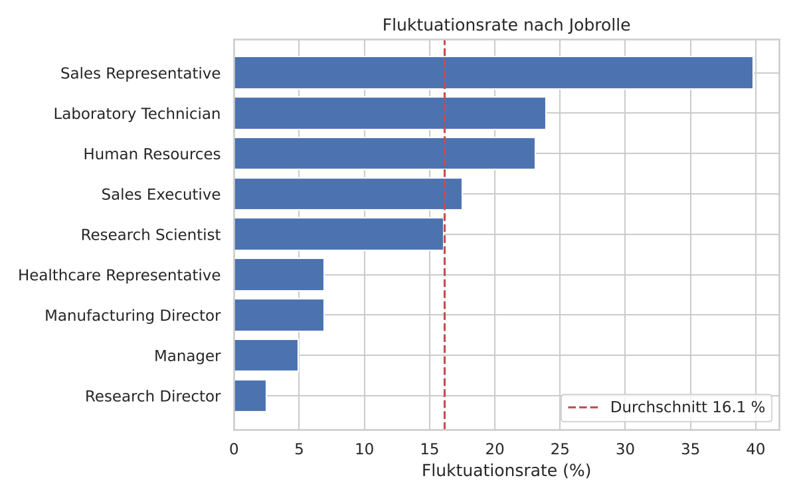

# HR Analytics – Mitarbeiterfluktuation

**Business-Frage:** Welche Mitarbeitergruppen kündigen überdurchschnittlich oft, und welche Faktoren hängen am stärksten mit der Fluktuation zusammen?

Analyse von 1.470 Mitarbeiterdatensätzen (IBM HR Analytics, Kaggle) mit Python.

*English version below.*

## Key Findings

- **Fluktuationsrate gesamt: 16,1 %** (237 von 1.470 Mitarbeitern).
- **Überstunden:** Mitarbeiter mit Überstunden kündigen fast **dreimal so häufig** (30,5 % vs. 10,4 %).
- **Einstiegsebene:** Job-Level 1 hat eine Rate von 26,3 %, die Altersgruppe 18–30 von 25,9 %.
- **Jobrolle:** Sales Representatives kündigen zu 39,8 %, Research Directors nur zu 2,5 %.
- **Gehalt:** Gekündigte verdienen im Median **38 % weniger** (3.202 vs. 5.204 USD pro Monat).
- **Weitere Risikogruppen:** häufig Reisende (24,9 %) und Ledige (25,5 %).
- Eine logistische Regression erreicht einen **ROC-AUC von 0,81** und bestätigt Überstunden, Jobrolle und Reisetätigkeit als wichtige Faktoren.





## Handlungsempfehlungen

1. Überstunden regelmäßig überwachen und ausgleichen.
2. Junge Mitarbeiter und Einstiegsebene durch Onboarding, Mentoring und klare Entwicklungspfade binden.
3. Vergütung und Arbeitsbedingungen von Sales Representatives gezielt prüfen.
4. Gehaltsbänder in den unteren Stufen überprüfen.

## Methodik

1. Datenprüfung: keine fehlenden Werte, keine Duplikate
2. Bereinigung: 3 konstante Spalten und die Mitarbeiter-ID entfernt
3. Vergleich von **Fluktuationsraten** je Gruppe (nicht absoluter Zahlen)
4. Gehaltsvergleich (Median, Mittelwert) und Korrelationsanalyse
5. Logistische Regression (scikit-learn) zur Einordnung der Einflussfaktoren

## Tools

Python · pandas · NumPy · Matplotlib · Seaborn · scikit-learn · Jupyter

## Projektstruktur

```
data/hr_employee_attrition.csv            Datensatz (Kaggle: IBM HR Analytics)
notebooks/hr_attrition_analysis.ipynb     Analyse
images/                                   Diagramme
requirements.txt
```

## Ausführen

```bash
pip install -r requirements.txt
cd notebooks
jupyter notebook hr_attrition_analysis.ipynb
```

---

## English

**Business question:** Which employee groups leave most often, and which factors are most strongly linked to attrition?

- Overall attrition rate: 16.1 %.
- Employees working overtime leave almost 3× as often (30.5 % vs. 10.4 %).
- Job level 1: 26.3 %; age 18–30: 25.9 %; Sales Representatives: 39.8 %.
- Employees who left earn 38 % less (median monthly income 3,202 vs. 5,204 USD).
- A logistic regression reaches ROC-AUC 0.81.

Recommendation: monitor overtime, strengthen onboarding and career paths for entry-level staff, review pay for Sales Representatives.
